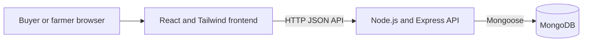
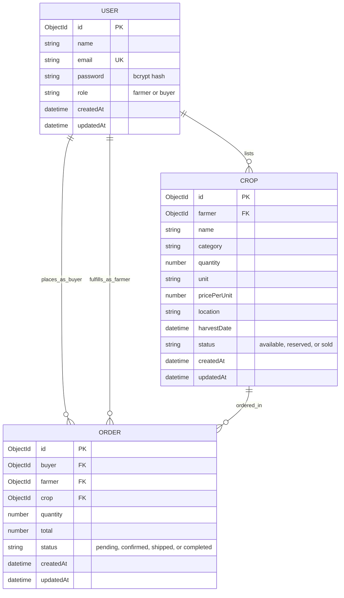

# AgriLink

AgriLink is a farmer-to-market direct trade platform. It is intended to help
farmers sell fresh produce directly to individuals, restaurants, and small
wholesalers, reducing reliance on unnecessary intermediaries.

Farmers can publish produce with its quantity, price, location, and harvest
date. Buyers can browse produce and place orders. The application is being
built as a web application with a React frontend, an Express API, and a
persistent database.

> **Implementation status:** The requested target stack lists PostgreSQL and
> JWTs in HTTP-only cookies. The current repository instead uses MongoDB with
> Mongoose, and the login page stores its JWT in `localStorage`. This README
> documents the code that can be run today and calls out those target-stack
> differences rather than implying they are already implemented.

## Features

- Farmer and buyer account registration and sign-in
- Farmer and buyer roles with role-specific dashboard routes
- Farmer produce records and buyer order records
- API authentication using JSON Web Tokens
- Docker Compose configuration for the frontend, backend, and database

The project brief calls for safe handling of concurrent orders so stock is not
oversold. That behavior requires atomic inventory updates or database
transactions; it should be verified and implemented before treating ordering
as production-ready.

## Technology

| Area | Requested target | Current repository |
| --- | --- | --- |
| Frontend | React, Tailwind CSS | React, Tailwind CSS, Vite |
| Backend | Node.js, Express.js | Node.js, Express.js |
| Database | PostgreSQL | MongoDB, Mongoose |
| Authentication | JWT in HTTP-only cookies | JWT returned to the frontend and stored in `localStorage` |
| Containers | Docker | Docker and Docker Compose configuration |
| CI/CD | Jenkins | Jenkins pipeline is not currently included |

## Architecture



## Data model

The following ER-style diagram describes the logical relationships in the
current Mongoose models. MongoDB stores these records as documents and uses
ObjectId references rather than SQL foreign keys.



`USER.password` is stored as a bcrypt hash by the registration API; never
store or commit a plain-text password. A crop references its farmer, while an
order references its buyer, farmer, and crop.

## Repository layout

```text
AgriLink/
├── backend/
│   ├── middleware/       # JWT authentication middleware
│   ├── models/           # User, Crop, and Order Mongoose models
│   ├── routes/           # Authentication and farmer API routes
│   ├── server.js         # Express app and MongoDB connection
│   └── Dockerfile
├── frontend/
│   ├── src/
│   │   ├── pages/        # Login and dashboard pages
│   │   ├── Components/   # Shared/legacy UI components
│   │   ├── App.jsx       # Browser routes
│   │   └── index.css     # Tailwind entry styles
│   └── Dockerfile
└── docker-compose.yml
```

## Run the application with Docker

### Prerequisites

- Git
- Docker Desktop with Docker Compose enabled

### 1. Get the code

```powershell
git clone https://github.com/Manura-yapa/AgriLink.git
cd AgriLink
```

If you already have the project files, open PowerShell in the repository
folder instead.

### 2. Start the services

```powershell
docker compose up --build
```

The first build may take a few minutes. Keep this terminal open to see service
logs. Docker Compose starts MongoDB, the Express API, and the Vite frontend.

### 3. Check that the services are ready

- Frontend: <http://localhost:5173>
- Backend status: <http://localhost:5000/api/status>
- MongoDB: `mongodb://localhost:27017/agrilink_db`

The status endpoint should return a JSON message indicating the backend is
running. The backend log should also show a successful MongoDB connection.

### 4. Register and sign in

1. Open <http://localhost:5173>.
2. Select **Register**.
3. Enter a name, email, password, and account role (farmer or buyer), then
   select **Create Account**.
4. After the registration confirmation, enter the same email and password on
   **Sign In**.
5. A farmer is sent to `/farmer`; a buyer is sent to `/buyer`.

The current frontend sends registration and login requests to
`http://localhost:5000/api/auth/register` and
`http://localhost:5000/api/auth/login`. For development, the Compose file
provides a JWT secret; replace it with a strong private value before using any
non-local environment.

### 5. Stop the services

Press `Ctrl+C` in the Compose terminal, then run:

```powershell
docker compose down
```

The MongoDB data is kept in the named `mongo_data` volume. To remove the
database data as well, run `docker compose down --volumes`; this permanently
deletes that local database.

## Run without Docker

For local development without running all services in Compose, install a
MongoDB server locally (or start only the Compose database with
`docker compose up mongodb`).

1. In `backend`, create a `.env` file:

   ```dotenv
   PORT=5000
   MONGO_URI=mongodb://127.0.0.1:27017/agrilink_db
   JWT_SECRET=replace-with-a-long-random-development-secret
   ```

2. In a PowerShell terminal, install and start the backend:

   ```powershell
   cd backend
   npm install
   npm run dev
   ```

3. In a second terminal, install and start the frontend:

   ```powershell
   cd frontend
   npm install
   npm run dev
   ```

4. Visit <http://localhost:5173>. The login page uses
   `http://localhost:5000` as its default API URL. If the API uses a different
   address, create `frontend/.env` with `VITE_API_URL` set to that API origin,
   then restart Vite.

Keep `.env` files private and do not commit real secrets.

## Login milestone: what the existing code does

The login screen is in `frontend/src/pages/Login.jsx` and is rendered at `/`
by `frontend/src/App.jsx`. Its **Register** form submits a name, email,
password, and role to `POST /api/auth/register`. The backend hashes the
password with bcrypt and saves a user record. **Sign In** submits the email
and password to `POST /api/auth/login`; on success, the frontend stores the
returned JWT, role, and name in browser `localStorage` and routes the user
based on their role.

Useful files when continuing this milestone:

- `frontend/src/pages/Login.jsx` — registration and sign-in UI/API calls
- `frontend/src/App.jsx` — `/`, `/farmer`, and `/buyer` routes
- `backend/routes/auth.js` — registration and sign-in endpoints
- `backend/models/User.js` — user fields and role values
- `backend/middleware/auth.js` — JWT verification for protected API routes

## Authentication and deployment notes

The current sign-in implementation is a development milestone, not a complete
production authentication design. The frontend stores the JWT in
`localStorage`, and the backend middleware reads a bearer token from the
`Authorization` header. The requested HTTP-only cookie flow is not yet wired
into the login and logout endpoints. Before deployment, move to secure,
HTTP-only cookies, configure cookie and CORS settings for the deployment
origins, use a strong environment-managed JWT secret, and add appropriate
session expiry and logout handling.

Similarly, the brief names PostgreSQL, but the current models and Compose
configuration use MongoDB. A PostgreSQL migration needs a schema/migration
strategy and updated API persistence code; changing only the database
container or the README would not complete that migration.

## Development checks

Run the frontend lint and production build from PowerShell:

```powershell
cd frontend
npm run lint
npm run build
```

The backend currently defines `npm run dev` and `npm start`; a backend test
suite is not configured yet.
